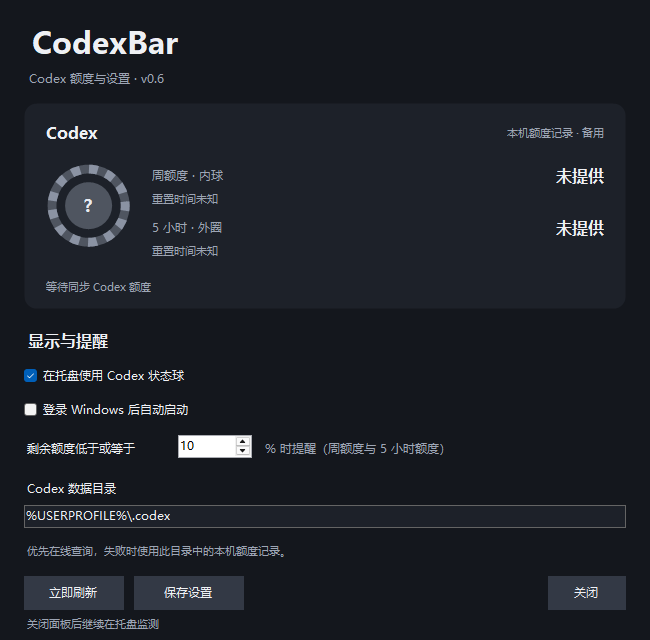

# CodexBar

[](https://github.com/yushuovo/CodexBar/actions/workflows/build.yml)
[](LICENSE)

**用一枚 Windows 托盘状态球，查看 Codex 的周额度与 5 小时额度。**

CodexBar 是一个个人开发的原生 Windows 小工具。启动后安静地留在托盘，右键即可查看额度、重置时间和相关设置。它是独立项目，并非 OpenAI 官方客户端。



*面板空状态预览，不包含真实账号信息。当前版本：0.6.0。*

## 功能

- **一球双额度**：内球表示周剩余，外圈表示 5 小时剩余；灰白表示剩余，深灰表示耗用。
- **纯托盘交互**：启动、左键和双击不弹窗；右键进入“Codex 额度与设置”。
- **每分钟同步**：优先查询 Codex 官方 App Server，失败时使用明确标注时间的本机快照。
- **连接恢复**：自动发现 Windows 当前登记的 Codex 安装，支持更新后路径失效恢复与连接重试。
- **日常设置**：状态球切换、低额度提醒、可选开机启动与自定义 Codex 数据目录。

## 开始使用

需要 Windows 10/11、.NET Framework 4.8，以及已安装并使用 ChatGPT 账户登录的 Codex。CodexBar 不需要单独填写 API Key。

### 下载运行

打开 [最新 Release](https://github.com/yushuovo/CodexBar/releases/latest)，在 **Assets** 中下载 `CodexBar.exe`，保存到固定文件夹后直接运行，无需安装。

也可以下载 `CodexBar-v0.6.0-windows.zip`，解压后运行其中的 `CodexBar.exe`。Release 中的 `SHA256SUMS.txt` 可用于核对下载文件。GitHub 自动提供的 **Source code** 是源码包；运行程序请选择 EXE 或 Windows ZIP。

启动后程序位于右下角通知区域，右键图标即可打开面板。更新前先从托盘退出旧版本，再替换 EXE；设置保存在程序目录之外。

### 从源码构建

```powershell
git clone https://github.com/yushuovo/CodexBar.git
cd CodexBar
powershell.exe -NoProfile -ExecutionPolicy Bypass -File .\build.ps1
.\dist\CodexBar.exe
```

构建使用 Windows 自带的 .NET Framework C# 编译器，不需要 Node.js、npm、NuGet 或 .NET SDK。也可以从本仓库 **Actions → 最近成功的 Windows build → CodexBar-windows** 获取构建产物。

### 托盘操作

| 操作 | 行为 |
| --- | --- |
| 悬停 | 查看周额度与 5 小时额度的剩余百分比 |
| 左键 / 双击 | 不打开窗口 |
| 右键 → Codex 额度与设置 | 在同一面板查看额度并修改设置 |
| 右键 → 立即刷新 | 在后台刷新 |
| 右键 → 使用 Codex 状态球 | 切换状态球与普通图标 |
| 右键 → 退出 | 停止监测并释放自有查询进程 |

关闭面板后会继续监测，未保存的修改会丢弃。重复运行 EXE 不会创建第二个实例。图标被系统收起时，可在 Windows 任务栏设置中将其设为常显。

## 数据与边界

在线来源为已安装 Codex 的 `account/rateLimits/read`，读取所选 Codex 数据目录对应的登录状态。CodexBar 不直接读取登录令牌，不创建聊天，也不发送模型推理请求。

在线查询失败时会尝试本机 `sessions` 额度记录，并保留失败阶段与原记录时间。超过 15 分钟没有新快照、或已过记录中的重置时间时，状态球显示问号，不自行补成 100%。本地快照不能证明当前登录账户归属。

这里只展示服务提供的额度窗口。某个窗口未提供时显示“未提供”，不估算剩余量，也不把订阅配额换算成金额。App Server 接口、本地日志格式与安装布局可能随 Codex 更新而变化。

## 配置与升级

设置位于 `%LOCALAPPDATA%\CodexBar\settings.json`。升级自 AIAPIBar 时，会迁移原有 Codex 设置、CLI 路径缓存和对应的开机启动项，不覆盖已存在的新配置。

| 项目 | 用途 |
| --- | --- |
| `CODEX_HOME` | 默认 Codex 数据目录，未设置时使用用户目录下的 `.codex` |
| `CODEXBAR_CODEX_EXE` | 指定特殊位置的 Codex CLI；旧的 `AIAPIBAR_CODEX_EXE` 仍兼容 |
| `runtime-status.json` | 本机诊断：连接阶段、来源、时间与额度快照 |
| `codex-cli.path` | 自动维护的 CLI 路径缓存 |

运行数据与诊断不进入 Git 仓库。日志只记录异常类型和调用位置，不记录响应正文或登录凭据。

## 开发与测试

```powershell
powershell.exe -NoProfile -ExecutionPolicy Bypass -File .\build.ps1
.\dist\CodexBar.Tests.exe
```

常规检查使用本地模拟服务，无需 Codex 账户或网络；GitHub Actions 在 Windows 上运行同一套构建与检查。需要真实账户的连接探针、退出重开和安装更新回归见 [开发说明](CONTRIBUTING.md)。

- [维护者上传与发布步骤](PUBLISHING.md)
- [更新记录](CHANGELOG.md)
- [Codex 官方 App Server 文档](https://learn.chatgpt.com/docs/app-server)
- [Windows 包家族查询](https://learn.microsoft.com/en-us/windows/win32/api/appmodel/nf-appmodel-getpackagesbypackagefamily)

## 许可证

[MIT](LICENSE) · Copyright (c) 2026 yushuovo
